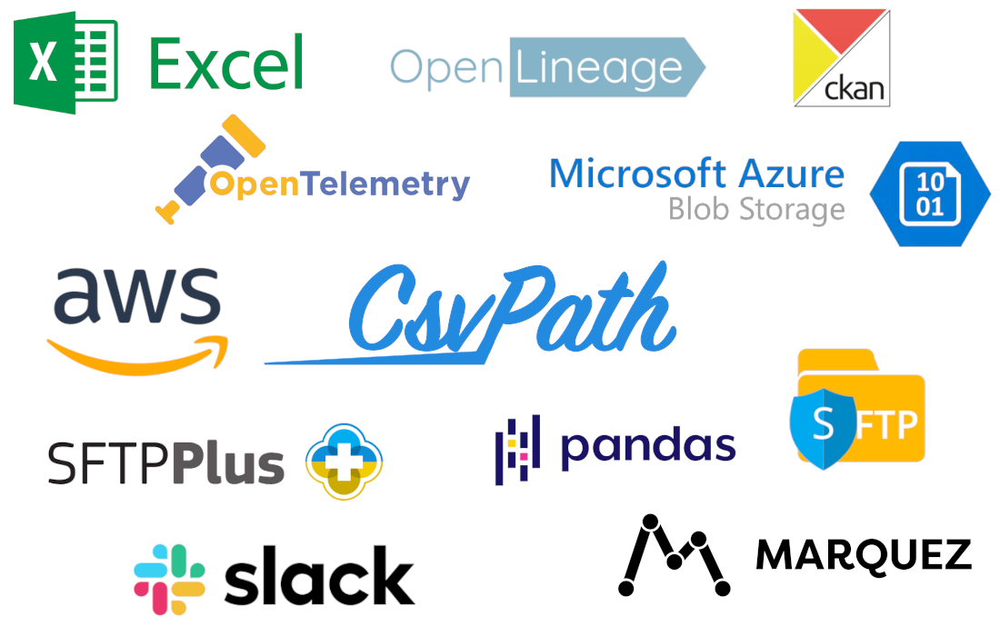

# How-tos

These quick how-to articles jump-start specific use cases and configurations. They don't cover the full range of CsvPath Framework functionality. If you don't see a how-to you're looking for[ please ask here](../../getting-started/a-helping-hand.md). And if you think your scenario needs more support from the Framework [please let us know](../../getting-started/a-helping-hand.md).

There are more how-tos in the [FlightPath Data docs](https://www.flightpathdata.com/docs.html) covering the app and how you use it develop for and manage the Framework in production. FlightPath also has [many built-in examples](validating-csv-and-excel/the-flightpath-data-examples/). Checkout [https://www.flightpathdata.com](https://www.flightpathdata.com/) for more.

<figure><figcaption></figcaption></figure>

CsvPath Framework is growing its list of pre-integrated tools week-by-week. If you don't see the tool you need, [just ask](../../getting-started/a-helping-hand.md).&#x20;

| Category                         | Tools                                                                                                                                                                                                                                                                                                                                                                                                                                                                                   |
| -------------------------------- | --------------------------------------------------------------------------------------------------------------------------------------------------------------------------------------------------------------------------------------------------------------------------------------------------------------------------------------------------------------------------------------------------------------------------------------------------------------------------------------- |
| **File Transfer**                | 

<ul><li><a href="storage-backends/aws-s3.md">AWS S3</a> and Transfer Family</li><li><a href="storage-backends/azure.md">Azure Blob Storage</a></li><li><a href="storage-backends/https.md">HTTP(S)</a>  <em>(read-only)</em></li><li><a href="storage-backends/google-cloud-storage.md">Google Cloud Storage</a></li><li><a href="sftp/sftp-export.md">SFTP</a></li></ul>

                                                                                                 |
| **Lineage**                      | 

<ul><li><a href="../../getting-started/observability-integrations/openlineage/openlineage-with-marquez-v1-2024.md">OpenLineage</a></li><li><a href="https://peppy-sprite-186812.netlify.app/">Marquez</a>, <a href="https://datahub.com/">DataHub</a>, DataDog Data Observability, and more</li></ul>

                                                                                                                                                                     |
| **Observability**                | 

<ul><li><a href="../../getting-started/observability-integrations/opentelemetry.md">OpenTelemetry</a> </li><li><a href="https://openobserve.ai/">OpenObserve</a>, <a href="https://grafana.com/">Grafana</a> </li></ul>
<em>More than 80 other monitoring and alerting venders support CsvPath Framework's OpenTelemetry pipeline events.</em> 
                                                                                                                            |
| **Data Formats**                 | 

<ul><li><a href="validating-csv-and-excel/">CSV</a> and any <em>X</em>SV</li><li>Excel</li><li><a href="validating-json/validating-json-documents.md">JSON documents and objects</a></li><li><a href="validating-json/validating-jsonl-with-jsonpath.md">JSONL</a></li><li>Pandas <a href="validating-dataframes.md">DataFrames</a></li><li>Embedded JSON and <a href="validating-xml/">XML</a></li><li><a href="parquet.md">Parquet</a></li></ul>

  |
| **Notifications**                | 

<ul><li><a href="setup-notifications-to-slack.md">Slack</a></li><li>Any <a href="../../getting-started/observability-integrations/opentelemetry.md">OpenTelemetry</a>-enabled monitoring platform </li><li>Any platform or app that offers <a href="call-a-webhook-at-the-end-of-a-run.md">webhooks</a>, including <a href="https://zapier.com/">Zapier</a>, <a href="https://ifttt.com/">IFTTT</a>, <a href="https://www.make.com/en">Make</a> and many others</li></ul>

 |
| **Data Publishing**              | 

<ul><li><a href="ckan/">CKAN</a></li></ul>

                                                                                                                                                                                                                                                                                                                                                                                                                                |
| **Metadata Databases**           | 

<ul><li><a href="send-events-to-mysql-or-postgres.md">MySQL</a></li><li><a href="send-events-to-mysql-or-postgres.md">Postgres</a></li><li><a href="send-run-events-to-sqlite.md">Sqlite</a></li></ul>

                                                                                                                                                                                                                                                                    |
| **Object and Data Lake Storage** | 

<ul><li><a href="storage-backends/s3-sftp-google-cloud-or-azure.md">AWS S3</a></li><li><a href="storage-backends/s3-sftp-google-cloud-or-azure.md">Azure Blob Storage</a></li><li><a href="storage-backends/s3-sftp-google-cloud-or-azure.md">Google Cloud Storage</a></li></ul>

                                                                                                                                                                                          |
| **Shell scripts**                | 

<ul><li>Any <a href="execute-a-script-at-the-end-of-a-run.md">command line shell</a> </li></ul>

                                                                                                                                                                                                                                                                                                                                                                           |
| **Data Processing**              | 

<ul><li>AWS <a href="csvpath-in-aws-lambda.md">Lambda</a></li><li>Apache <a href="https://github.com/flightpathdata/airflow-provider-flightpath">Airflow</a></li></ul>

                                                                                                                                                                                                                                                                                                    |
| **Validation Languages**         | <ul><li><a href="validating-json/">JSON Schema</a></li><li><a href="validating-with-odcs.md">ODCS</a></li><li><a href="validating-xml/">XSD</a></li><li><a href="validating-csv-and-excel/">CsvPath Validation Language</a></li><li><a href="validating-xml/">XPath</a> (as part of XSD or CsvPath Validation Language)</li><li><a href="validating-json/validating-jsonl-with-jsonpath.md">JSONPath</a> (as part of CsvPath Validation Language)</li></ul>                             |

